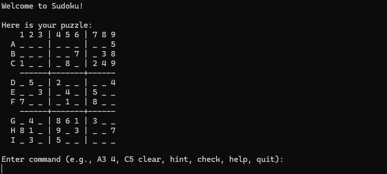

# Sudoku

A C# console Sudoku game using .NET 8. Each new puzzle has 30 starting numbers and one solution.



## Setup

Requires the .NET 8 SDK on Windows, Linux, or macOS. Internet access is needed the first time to download the xUnit test packages. The game itself has no external packages.

Clone the repository or download and extract the ZIP. Open a terminal in the folder containing `Sudoku.sln`:

```sh
dotnet restore Sudoku.sln
dotnet build Sudoku.sln --configuration Release
dotnet run --project src/Sudoku.Console --configuration Release
```

To run the tests:

```sh
dotnet test Sudoku.sln --configuration Release
```

For Visual Studio 2022, open `Sudoku.sln` and set `Sudoku.Console` as the startup project. .NET 8 support is required.

## Playing

Rows are A-I, columns are 1-9, and `_` means an empty cell.

| Command | Action |
| --- | --- |
| `B3 7` | Put 7 in row B, column 3 |
| `C5 clear` | Clear a cell |
| `hint` | Reveal one correct number |
| `check` | Check for duplicates |
| `help` | Show the commands |
| `quit` | Exit |

Commands accept upper or lower case and extra spaces. After completing a puzzle, enter `y` to play again. Any other response exits, as does end-of-input.

## Design and assumptions

- `SudokuGame` stores the board, starting cells, and solution. Zero is used for an empty cell. It copies the supplied arrays so outside changes cannot affect the game.
- `CommandParser` reads commands. `ConsoleGame` handles input and display. It accepts a reader, writer, and `IPuzzleGenerator` so the console flow can be tested with a fixed puzzle.
- `SudokuValidator` checks rows, columns, and 3x3 boxes. Starting numbers cannot be changed. Entered numbers must be 1-9.
- Duplicate entries are allowed when making a move, then reported by `check`, following the problem's examples. A partial board with no duplicates can still contain a wrong answer.
- A hint corrects an existing wrong entry first, otherwise it fills an empty cell. It changes one cell and leaves that cell editable.
- The game finishes only when every cell is filled and there are no rule violations.

The generator starts with a valid grid, shuffles digits and legal row/column groups, then removes numbers until 30 remain. After each removal, a backtracking solver checks that there is still only one solution. It stops counting at two solutions and tries the empty cell with the fewest candidates first. If a removal order cannot reach 30 clues, generation retries, up to 20 attempts, then reports a failure. There are no difficulty levels.

Tests cover moves, locked cells, clearing, parsing, duplicate checks, hints, completion, solution counting, puzzle generation, and full console sessions including replay and end-of-input. Fixed random seeds keep generator tests repeatable.
